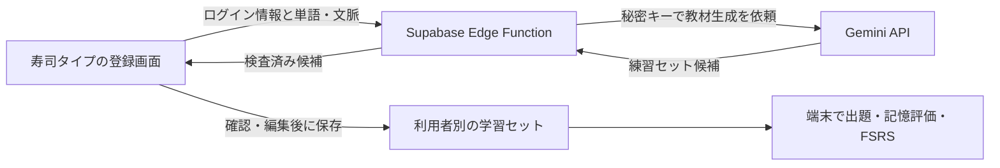

# AIで登録を助ける：基本語の用法から、覚えたい表現へ

元の寿司タイプ向けの設計案。AI生成・新しい登録画面・段階の解放はまだ実装していない。[意味のセットの案](meaning-set-design.md)を、AI必須という要望に合わせて具体化する。水族館の単体プロトタイプとは別の検討。

『5分間英単語』を基礎教材の起点にする案は、[書籍の調査と基礎学習の設計](foundation-book-plan.md)を参照。対象用法と周辺語を分け、基礎修了・発展の解放・あとで学ぶ語の保存をどう扱うか検討している。

## AIが作るもの

ユーザーは「覚えたい語・表現」と、任意で「出会った一文」「使いたい場面」を入力する。AIは今回の意味を絞り、やさしい言い換え・必要な基本語の用法・対象語を使う例文を提案する。編集可能なプレビューを経て登録する。

「簡単な単語だから既知」「名詞だから簡単」とは決めない。`take` 全体を習得済みにするのではなく、`take a break`、`take responsibility for ...` などの用法ごとに扱う。`bank` のような名詞も語義を選ぶ。語の難しさの推定と、そのユーザーが使えるという証拠を分ける。

| 登録したもの | AIが提案する入口 |
| --- | --- |
| apple・果物の意味 | 単語の直接練習。不要な前提問題を増やさない |
| assume responsibility for ...・責任を引き受ける | take responsibility for ... の用法を確認して、対象表現へ進む |
| exacerbate・問題などを悪化させる | make the problem worse → exacerbate the problem → 場面に合う文 |
| take・文脈なし | 今回覚える用法を選んでもらう。全用法を一度に登録しない |

上の対はこの設計の説明用。文型・目的語・語感を含めて比較し、すべての場面で自由に置換できるとは扱わない。`take / have / go` を必ず使う制約も置かない。今回の意味に合う、自然で身近な表現を優先する。

既に同じ用法を学んでいれば、安定した用法IDで前提カードを再利用する。生成した文字列が似ているだけで異なる語義の学習記録をまとめない。AIが推測した類似関係は、既知扱いにする根拠にしない。

## 登録から出題まで

1. 単語・表現を入力。元の一文があれば添える。
2. 複数の意味が候補になる場合は、短い意味の選択を挟む。
3. AIが「基本の言い方」「対象の表現」「例文」「使い分け」「許容する別解」をまとめて生成。
4. 登録前の画面で確認・編集。ユーザーがセットを保存する。
5. 初回紹介後は、意味・場面と頭文字から答える問題を高速に回す。最初から表示する頭文字と、途中で増える追加ヒントを区別する。
6. 基本の言い方を取り出せる記録があれば、対象の表現を少しずつ出題に混ぜる。後日はFSRSで復習する。

既知の用法は短い確認で先へ進める。練習を飛ばす選択も用意できるが、自己申告のスキップを記憶確認の正解やFSRSのGoodへ変換しない。

生成や確認は登録時にまとめる。各皿の途中にAIへの通信・長い解説・確認ボタンを入れず、正解から次の皿へ進む今のテンポを保つ。

## 3コースとの対応

見せ方の候補は「お手軽＝基本の言い方」「お勧め＝対象の表現・組み合わせ」「高級＝文で使う」。既存の単語・熟語・例文コースからの変更になるため、実装前に小さなセットで試す。

学習段階と入力文字数は別の値として持たせる。`make the problem worse` は `exacerbate` より長く、基本語の練習でも3秒入力には向かない場合がある。

- 現在の3秒・5秒・10秒という設定は、この文書の追加では変更しない。
- 初期試作では、基本語の用法を単語の穴埋めにする、長い言い換えは5秒側へ案内するなど、出題の長さも含めて確認する。
- コースだけで解放条件や記憶評価を決めない。同じセットでも段階・出題方向・手掛かり条件ごとに記録する。

## 「次へ進める」と「覚えている」を分ける

最初の試作で試すルールは次のとおり。効果が確立した閾値ではなく、使って調整する仮設定。

| 状態 | 扱い |
| --- | --- |
| 初回・不明 | やさしい言い方を紹介し、支援付きで練習 |
| 別ラウンドで、頭文字を見て追加ヒントなしで2回成功 | 対象表現の練習を混ぜ始める。同じ日の成功だけで長期定着とは表示しない |
| 翌日以降の期限到来の復習でも成功 | 後日も思い出せた記録として表示し、次の復習をFSRSで決める |
| 追加の文字ヒント・答え表示・想起失敗 | その用法を復習へ戻す。既に進んだ段階の閲覧まで禁止しない |

### 標準の到達目標は「頭文字で思い出せる」

ユーザーの希望に合わせ、頭文字から「あの表現だ」と取り出せることを、基礎修了・次段階の解放に使う。完全に手掛かりがない課題への成功は必須にしない。画面では「追加ヒントなし」または「頭文字で思い出せた」と表現する。

- 初期手掛かりは、答え全体の最初の英字1文字。たとえば「決める」に `d…` を添えて `decide`、別の練習では `m…` を添えて `make a decision` を取り出す。各単語の頭文字をすべて見せる条件とは分ける。
- 頭文字だけの確認では `d…` のように文字数を示さない表示を使う案。現行アプリの頭文字＋空欄による文字数表示（initial-and-length）は別の条件として残し、過去の記録を頭文字だけの成功に読み替えない。この文書では表示処理を変更しない。
- ミスに応じた文字の開示や「次の1文字」の操作は追加ヒント。初期の頭文字を見ただけでは追加ヒント使用に数えない。単なる打鍵ミスと、文字が追加されたことも分ける。
- 同じ意味を伝える複数の表現を、対象ごとのカードとして持てるようにする。頭文字だけでは候補が1つにならない場合は、同じ語義・文型に合う登録済み別解を受け付ける。対象語を限定したい問題では、その条件を明示する。
- 後日の成功も、同じ頭文字条件で確認する。「完全に手掛かりなしでも言えた」という記録と混同しない。既存の手掛かりなしモードは任意の確認として残す。

タイピングの遅さによる時間切れと、思い出せなかった記録も区別する。速度だけで習得済みにはしない。2回という解放閾値は引き続き試作の仮設定であり、頭文字付きの成功を自由会話の習得証明にはしない。

基本表現・対象語・文章には別々のFSRS状態を持たせる。基本表現の成功から、未確認の難語へGoodを付けない。解放のための当日練習でFSRSの期限を何度も伸ばすこともしない。既存の期限前・追加練習の扱いを維持する。

直前の基本表現が答えを教えてしまわないよう、別セットを間に挟む。後の練習では別文脈も使い、同じ例文だけを覚えた状態との違いを見る。自由会話で使えることまで、タイピングの結果だけで判定しない。

## Gemini APIの使い方

APIは、アプリからGoogleへ「この語の練習セットを作って」と依頼し、結果を受け取るための窓口。利用者全員がAPIキーを取得する方式ではなく、アプリの運営者が接続を設定する方式を推奨する。

GeminiのFlash系を最初の候補にする。モデルの選択は、語義の区別、言い換えの自然さ、例文の誤り、日本語の説明、速度、実際の費用で比べる。モデル名はサーバー設定で替えられるようにし、リリース時の安定版と価格を再確認する。最も新しいモデルなら教材が正しい、とは判断しない。

JSON Schemaによる構造化出力で、以下の項目を持つデータを受け取る案。これは内部データの案で、完成したAPI仕様ではない。

```text
schema_version
target: term, sense_ja, part_of_speech, usage_pattern
prerequisites[]: usage_id_candidate, expression, meaning_ja, example
basic: prompt_ja, answers[], example_en, example_ja
target_practice: prompt_ja, answers[], usage_note_ja
sentences[]: scenario_ja, basic_en, advanced_en, accepted_answers[]
needs_clarification, clarification_options[]
```

AIは教材候補と前提用法を返す。学習済みフラグ・FSRS状態・解放判定・報酬は返させず、アプリ側が実際の記録で決める。

構造化出力でも意味や文法の正しさは保証されない。サーバーで型・件数・長さ・空欄・対象表現の有無を検査し、意味や自然さは編集可能なプレビューでも確認する。自動検査に通っただけで「辞書確認済み」とは表示しない。単語だけで意味が絞れない場合は質問を返す。

自由回答を毎回AIで採点する機能は最初の範囲から分ける。初期版は登録した複数の別解を受け付け、未登録の回答は表現を追加できる形にする。AIの返答待ちや判定の揺れで、皿の進行を止めない。

## 現在の構成への接続案



- 今のログインを利用し、関数側でユーザーの認証を確認する。リクエスト本文のuser_idを信用せず、認証情報のユーザーを所有者とする。
- Geminiの秘密キーはSupabase Edge FunctionのSecretsに設定する。ブラウザ配信のdistやGitHubへ入れない。現在のSupabase公開キーとは別物。
- 最初は登録時に1セットずつ生成し、保存した教材を出題で再利用する。既存教材を使うだけのプレイではAIを呼ばない。
- 利用者ごとの生成回数上限、同時実行制限、入力・出力の上限を設ける。重複送信には同じ処理IDを用い、意図しない二重生成を防ぐ。上限は運営側で調整する。
- 保存は既存の利用者別データに接続し、親セットと各段階のカードに安定したIDを持たせる。AIが返したIDを認証・所有権判定に使わない。容量が増える場合は、RLS付きのセット専用テーブルへの分離を検討する。
- 接続障害や回数制限では入力を残して再試行できるようにする。生成できないときも、保存済みの学習と従来のMarkdown登録を利用できるようにする。

## 運営者が最初に設定すること

1. Google AI StudioでGemini APIを使うプロジェクトとAPIキーを用意する。
2. 対象モデルの無料枠・回数制限・料金・データの扱いを確認する。一般公開の運営では有料枠も含めて見積もる。
3. Supabase管理画面のEdge Function Secretsへキーを保存する。秘密キーをチャットに貼る必要はない。
4. 開発側で関数と登録UIを実装・配置し、実接続で確認する。

無料枠が一般公開の全利用を賄うとは想定しない。生成の費用は主に入力・出力の量とモデルで変わるため、小さなサンプルで実測し、登録1回あたりの平均と上限を決める。予算通知だけに頼らず、アプリのサーバー側にも生成回数の上限を持たせる。

初期の品質確認には、具体名詞、多義語、基本動詞の複数用法、難語の動詞、句動詞を含む20件程度を使う。基本表現が自然か、語義がずれないか、既知の内容を余分に繰り返さないか、登録を終えられるかを見る。その後、後日も頭文字から追加ヒントなしで思い出せるか、別文脈でも回答できるかを測る。

## 参照先と調査範囲

2026-11-06に公式資料の検索結果を確認。Googleの下記ページは直接取得時にtext/markdownが非対応となったため、本文全体を読了したとは扱わない。実装時に利用するSDK・モデル・設定を再確認する。

- [Geminiの構造化出力](https://ai.google.dev/gemini-api/docs/structured-output)：JSON Schemaの一部を使った応答形式、内容の検証が必要である点。
- [Gemini APIキー](https://ai.google.dev/gemini-api/docs/api-key)と[開始方法](https://ai.google.dev/gemini-api/docs/get-started)：AI Studioでの準備の入口。
- [Gemini料金](https://ai.google.dev/gemini-api/docs/pricing)・[利用制限](https://ai.google.dev/gemini-api/docs/rate-limits)：モデル・利用枠ごとの条件を確認する先。無料枠と有料枠ではデータ利用条件も確認する。
- [Supabase関数の認証](https://supabase.com/docs/guides/functions/auth)・[Secrets](https://supabase.com/docs/guides/functions/secrets)：ログイン利用者を確認する関数と、APIキーをサーバーに保存する方法。
- 学習設計の根拠と限界は[意味のセットの案](meaning-set-design.md)と[研究メモ](research/learning-evidence.md)を参照。AIによる教材生成や上記の解放閾値そのものの効果を、これらの研究で実証済みとはしない。
